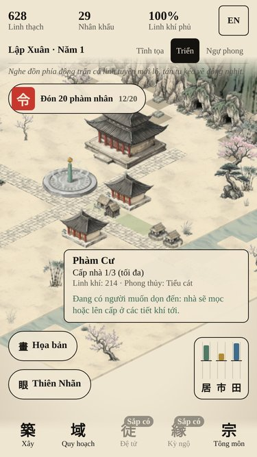

# Mặc Họa Tiên Thành · Ink Immortal City

**VI** — Game mô phỏng xây dựng tông môn tiên hiệp kiểu SimCity, vẽ theo phong cách thủy mặc isometric. Chạy trên web (PWA), ưu tiên chơi bằng điện thoại.

**EN** — A SimCity-style xianxia sect builder in ink-wash isometric art. Runs in the browser as a PWA, mobile-first.

- GDD: [Claude Docs — GDD Mặc Họa Tiên Thành](https://claude.ai/artifact/C2RKDi6kdrZM2oGEKfad6W) · tóm tắt trong [`docs/GDD.md`](docs/GDD.md)
- Trạng thái / Status: **prototype lõi** — xây công trình, linh lộ, quy hoạch phàm trần tự mọc nhà (Tam Tài Khí), phong thủy, Thiên Nhãn, lưu game, mô phỏng trong Web Worker, HUD song ngữ, họa bản AI.



## Chạy thử / Run

Đã kiểm tra với **Node.js 22 và 24**. / Tested with **Node.js 22 and 24**.

```bash
npm ci
npm run dev        # http://localhost:5173 — đã bật sẵn --host, điện thoại cùng Wi-Fi mở được bằng IP máy
npm test           # test mô phỏng + kiểm tra đủ bản dịch
npm run build      # kiểm tra kiểu + đóng gói PWA vào dist/
npm run preview    # chạy thử bản production (có service worker, chơi offline)
```

Game chạy bằng tài nguyên có sẵn trong repo; khóa Gemini chỉ cần khi tự sinh thêm ảnh. / The game runs on assets already in the repo; a Gemini key is only needed to generate new art.

## Năm phút đầu / First five minutes

1. Trưởng lão Mặc Vân giới thiệu HUD (xem lại: Tông môn → Xem lại hướng dẫn). / Elder Mo Yun tours the HUD (replay: Sect → Replay the tutorial).
2. Chạm thẻ **令 Thiên Đạo Lệnh** ở góc trên → **Chỉ cho tôi**: game cầm sẵn công cụ Linh lộ và đánh dấu ô 一, 二. Chạm 一 rồi 二, bấm **Làm đường** — Tĩnh Xá lẻ loi có linh khí, nhận 100 linh thạch. / Tap the **令 decree** card → **Show me**: the Spirit Road tool is picked and tiles 一, 二 are marked. Tap 一, then 二, then **Build road**.
3. Lệnh kế: quy hoạch Phàm Cư cạnh linh lộ — vài nhà mọc ngay; chạm một lô để xem vì sao nó (chưa) mọc. Bấm **Ngự phong** để tua nhanh. / Next: zone Homes beside a road — a few houses appear at once; tap a lot to see why it is (not) growing. Use **Ride the Wind** to fast-forward.

## Thao tác / Controls

| Thao tác | Tác dụng |
| --- | --- |
| Kéo một ngón / Drag | Di chuyển bản đồ / Pan |
| Chụm hai ngón, lăn chuột / Pinch, wheel | Phóng to thu nhỏ / Zoom |
| Chạm công trình / Tap a building | Xem thẻ thông tin, lượng linh khí |
| Chạm lô quy hoạch / Tap a zoned lot | Cấp nhà, cấp tối đa, lý do chưa mọc / Level, max level, why it isn't growing |
| Công trình / Buildings | Kéo bản đồ cho tâm màn hình vào chỗ muốn đặt, bấm Đặt / Drag the map to aim the centre mark, tap Place |
| Linh lộ, quy hoạch / Roads, zones | Chạm điểm đầu (góc 1) rồi điểm cuối (góc 2), bấm xác nhận / Tap start (corner 1), then end (corner 2), then confirm |
| Nút Thiên Nhãn / Heavenly Eye | Bật lớp phủ linh khí / Qi overlay |
| Nút EN / VI | Đổi ngôn ngữ / Switch language |

## Cấu trúc / Layout

```
src/
  sim/        logic mô phỏng thuần TypeScript, không phụ thuộc Three.js (có test)
  render/     Three.js: camera isometric 2:1, shader mực 5 nấc, khối thô công trình
  ui/         HUD Preact (màn dọc, một tay)
  i18n/       vi.json, en.json, glossary.json (bảng thuật ngữ — nguồn duy nhất)
docs/         GDD tóm tắt, ghi chú pipeline đồ họa AI
```

## Mục tiêu thiết bị / Target devices

iPhone SE (2020) và Samsung Galaxy Note 10 trở lên. Máy yếu tự chuyển mức đồ họa "Giản".

## Giấy phép / License

Mã nguồn công khai để tham khảo, chưa cấp phép dùng lại: giữ mọi quyền (`UNLICENSED` trong `package.json`). / Source is public for reference only — all rights reserved, no licence granted yet (`UNLICENSED` in `package.json`).

## Pipeline đồ họa AI / AI art pipeline

Toàn bộ hình ảnh do AI vẽ (GDD mục 3.4). Bước hiện có:

1. **Khối thô → ảnh đầu vào** (đã có sẵn trong `art/blockout/`): `npm run dev`, rồi `npm run art:render` (cần Python + Playwright).
2. **AI vẽ bằng Gemini (Nano Banana):**
   ```bash
   cp .env.example .env        # điền GEMINI_API_KEY
   npm run art:gen -- --b chinhDien --n 4
   npm run art:gen -- --list   # xem model ảnh khóa của bạn dùng được
   ```
   Ảnh ra ở `art/generated/<loại>/`, mở `art/generated/index.html` để so với khối thô.
3. Phong cách sửa ở `tools/art/style-prompt.md`; mô tả từng công trình ở `tools/art/subjects.json`.
4. **Không có khóa API?** Dùng prompt dán tay trong [`tools/art/PROMPTS.md`](tools/art/PROMPTS.md) với Gemini app hoặc AI Studio.

5. **Tách nền → sprite game:** lưu ảnh chọn vào `art/source/<loại>_vN.png`, chạy
   `python tools/art/cutout.py art/source/chinhDien_v1.png chinhDien` → `public/sprites/chinhDien.webp`.
   Game tự đặt sprite khớp ô đất; nút **Họa bản / Khối thô** để so.

Loại có sẵn: `chinhDien`, `tinhXa`, `tuLinhTran`, `duocVien`.

**Biến thể cây/đá (sprite sheet 3×3):** prompt trong [`tools/art/SHEET_PROMPTS.md`](tools/art/SHEET_PROMPTS.md), đính kèm `art/blockout/sheet_guide_*.png`. Cắt sheet: `python tools/art/sheet.py art/source/tung_sheet_v1.png tung --holes-min 4` → `public/sprites/decor/tung.webp` + `.json` (`--holes-min 4` làm trong cả kẽ lá trắng nhỏ; **không** dùng cho sheet nhà vì sẽ đục tường vôi). Game tự bốc biến thể theo ô, lật trái/phải; loại chưa có sheet dùng ảnh đơn.

**Địa hình** (núi, cây, đá, texture ô): prompt trong [`tools/art/TERRAIN_PROMPTS.md`](tools/art/TERRAIN_PROMPTS.md), danh sách ở `tools/art/terrain.json`. Vật thể dùng ảnh khung `art/blockout/guide_*.png` (sinh bằng `python tools/art/guides.py`).
